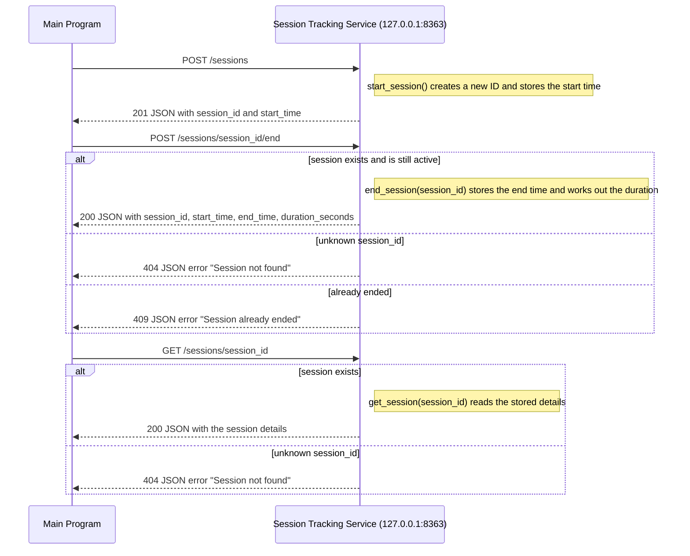

# CS361 Session Tracking Microservice

## What it does
This microservice records how long a session lasts. A program starts a session and gets back a unique session ID and the start time. Later it ends that session and gets back the duration in seconds. At any time it can look up a session's details by ID.

The service runs locally and uses HTTP with JSON. Both programs must run on the same computer.

- **Address:** `http://127.0.0.1:8363`
- **Data format:** JSON in every response
- **Storage:** sessions are kept in memory, so they are cleared when the service stops, and IDs start again at `s001`

## How to run it
```
pip install -r requirements.txt
python session_service.py
```

---

# Communication contract

## How to REQUEST data

| Action | Request | Parameters |                                                                   #5
|---|---|---|
| Start a session | `POST /sessions` | none |
| End a session | `POST /sessions/<session_id>/end` | `session_id` in the URL |
| Get a session | `GET /sessions/<session_id>` | `session_id` in the URL |

Example call (Python):

```python
import requests

BASE = "http://127.0.0.1:8363"

# Start a session
response = requests.post(BASE + "/sessions")
session_id = response.json()["session_id"]                                                          #6
# End the session
response = requests.post(f"{BASE}/sessions/{session_id}/end")

# Look the session up
response = requests.get(f"{BASE}/sessions/{session_id}")
```

## How to RECEIVE data

Every response is JSON. Read it with `response.json()`.

| Request | Success | Failure |                                                                     #7
|---|---|---|
| Start | `201` + `{"session_id": "s001", "start_time": "2026-11-10T02:00:00Z"}` | none |
| End | `200` + session details (below) | `404` + `{"error": "Session not found"}` |
| Get | `200` + session details (below) | `404` + `{"error": "Session not found"}` |

Session details for a completed session:

```json
{"session_id": "s001",
 "start_time": "2026-11-10T02:00:00Z",
 "end_time": "2026-11-10T02:01:00Z",
 "duration_seconds": 60}
```

Example call (Python):

```python
result = response.json()
print(result["duration_seconds"])                                                                   #8
```

Behavior in cases the contract does not spell out:
- Looking up a session that has not ended returns `200` with `"end_time": null` and `"duration_seconds": null`.
- Ending a session that has already ended returns `409` + `{"error": "Session already ended"}`, and the first end time is kept.
- An unknown URL or wrong method returns a JSON `{"error": ...}`.
- After any error the service keeps running and handles the next request normally.

## UML sequence diagram



---

## Test programs
With the service running, in a second terminal:

```
python test_session_service.py            # sends requests and prints each response (about 3 seconds)
python test_session_service.py --full     # also waits a real 60 seconds for the accuracy check
python test_session_accuracy.py           # controlled 60 second accuracy test with a fake clock
```